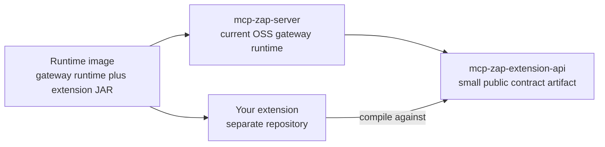

# Build Your Own Extension

Build a separate extension JAR for `mcp-zap-server` using the experimental
`mcp-zap-extension-api` and Spring Boot auto-configuration. The API uses local
Maven staging and does not guarantee binary compatibility across releases.

## Current State

Supported today:

- core exposes extension contracts in the shared codebase
- a dedicated `mcp-zap-extension-api` artifact is built by the project
- the repository contains sample extensions
- the sample compiles against the API artifact instead of the full runtime
- the sample packages separately from the gateway runtime
- the sample does not contain core, enterprise, or application classes
- Spring Boot auto-configuration registers the sample's provider beans
- a standalone example project shows the external builder shape

Not supported as a stable external platform yet:

- a public Maven Central release of `mcp-zap-extension-api`
- binary compatibility guarantees for third-party extension JARs
- dynamic plugin discovery
- marketplace-style plugin installation
- runtime multi-engine support

Keep your extension separate from the gateway build rather than forking core or
editing its `build.gradle` to add behavior.

<a id="target-developer-model"></a>

## Extension Structure

Use this dependency structure:



In that model:

- the current OSS gateway runtime owns the MCP tools and runtime orchestration
- the API artifact supplies extension contracts for the selected version
- your extension implements one or more contracts
- the runtime loads your extension through classpath-based Spring wiring
- normal MCP clients keep using the same gateway endpoint and tool names

## Pick A Small Extension Type First

Good first extensions:

- policy hook that allows, denies, or audits selected tools
- access boundary that scopes demo data in a single trust boundary
- metadata or evidence enrichment provider

Bad first extensions:

- a second scanner engine
- a forked MCP tool surface
- direct ZAP ClientApi calls from product logic
- secret or file loading controlled by tool callers
- tenant isolation claims without authz, durable store, and evidence tests

Scanner engine adapters and runtime engine switching are outside this API's
supported extension surface.

## Standalone Project Shape

Keep an external extension in its own repository.

Example layout:

```text
acme-mcp-zap-extension/
  build.gradle
  src/main/java/com/acme/mcpzap/extension/
    AcmeExtensionAutoConfiguration.java
    AcmePolicyHook.java
  src/main/resources/
    META-INF/spring/org.springframework.boot.autoconfigure.AutoConfiguration.imports
    META-INF/mcp-zap/extensions/acme.properties
  src/test/java/com/acme/mcpzap/extension/
    AcmePolicyHookTest.java
```

That layout does two different jobs:

- `META-INF/spring/...AutoConfiguration.imports` tells Spring how to discover
  your extension configuration when the JAR is on the runtime classpath.
- `META-INF/mcp-zap/extensions/*.properties` describes the extension for the
  gateway/operator contract.

Classpath alone is not enough. A JAR can compile and still never wire into the
runtime if Spring has no registration metadata or import hook.

## Gradle Dependency

An external extension should depend on the API artifact instead of depending on
the full application.

Local extension API dependency example (version `0.17.0`, resolved from a locally
staged Maven repository):

```gradle
plugins {
    id 'java-library'
}

def extensionApiVersion = providers.gradleProperty('extensionApiVersion')
        .orElse('0.17.0')
        .get()
def extensionApiGroup = providers.gradleProperty('extensionApiGroup')
        .orElse('io.github.dtkmn')
        .get()
def extensionApiRepositoryUrl = providers.gradleProperty('extensionApiRepositoryUrl')
        .orElse('../mcp-zap-server/build/extension-api-public-preview-publication')
        .get()

repositories {
    exclusiveContent {
        forRepository {
            maven {
                url = uri(extensionApiRepositoryUrl)
            }
        }
        filter {
            includeGroup extensionApiGroup
        }
    }
    mavenCentral()
}

dependencies {
    compileOnly "${extensionApiGroup}:mcp-zap-extension-api:${extensionApiVersion}"
    compileOnly 'org.springframework.boot:spring-boot-autoconfigure:4.1.1'

    testImplementation 'org.junit.jupiter:junit-jupiter:6.0.1'
    testImplementation 'org.assertj:assertj-core:3.27.6'
    testRuntimeOnly 'org.junit.platform:junit-platform-launcher:6.0.1'
}

tasks.named('test') {
    useJUnitPlatform()
}
```

First stage the API from the gateway repository:

```bash
./gradlew publishExtensionApiPublicPreviewPublicationToExtensionApiPublicPreviewStagingRepository
```

Alternatively, `./gradlew standalonePolicyMetadataExtensionJar` stages the API
and compiles the bundled standalone sample. Both are optional developer tasks;
normal builds do not stage or verify the Maven publication.

The `exclusiveContent` block is intentional: it prevents
`io.github.dtkmn:mcp-zap-extension-api` from resolving from Maven Central or a
stale public mirror while this example is supposed to use the freshly staged
artifact.

This coordinate describes the planned public-preview publication shape. Treat
it as experimental until the project publishes a public artifact repository and
declares a stable compatibility level:

```text
io.github.dtkmn:mcp-zap-extension-api:<version>
```

That coordinate is not published yet. Keep using the staged
`extensionApiRepositoryUrl` flow until the release policy says the public
preview artifact is available on Maven Central.

The explicit Spring, JUnit and AssertJ versions make these third-party
dependencies resolvable without relying on this repository's build. Maintain
their compatibility with the selected API and gateway versions.

## Bean Registration

Use Spring Boot auto-configuration or another documented registration mechanism
so the gateway can discover your extension beans.

Target shape:

```java
package com.acme.mcpzap.extension;

import mcp.server.zap.extension.api.policy.PolicyBundleAccessBoundary;
import org.springframework.boot.autoconfigure.AutoConfiguration;
import org.springframework.boot.autoconfigure.condition.ConditionalOnMissingBean;
import org.springframework.boot.autoconfigure.condition.ConditionalOnProperty;
import org.springframework.context.annotation.Bean;

@AutoConfiguration
@ConditionalOnProperty(
        prefix = "acme.mcp-zap.extension",
        name = "enabled",
        havingValue = "true"
)
public class AcmeExtensionAutoConfiguration {

    @Bean
    @ConditionalOnMissingBean(PolicyBundleAccessBoundary.class)
    PolicyBundleAccessBoundary acmePolicyBoundary() {
        return new AcmePolicyBoundary();
    }
}
```

And register it:

```text
# src/main/resources/META-INF/spring/org.springframework.boot.autoconfigure.AutoConfiguration.imports
com.acme.mcpzap.extension.AcmeExtensionAutoConfiguration
```

Include the auto-configuration metadata in the extension JAR, then check that
the expected bean loads in the gateway version you intend to deploy.

## Extension Metadata

Every external extension should describe itself with low-risk metadata.

Example:

```properties
id=acme-policy-metadata
name=Acme Policy Metadata Extension
dependsOn=mcp-zap-extension-api
loadsVia=spring-auto-configuration
private=false
type=policy-metadata
```

Metadata should not contain secrets, customer names, private paths, or
environment-specific IDs.

## Runtime Loading

Load the extension through the application classpath:

1. build the current OSS gateway runtime
2. build the extension JAR
3. build a custom runtime image or launch profile that puts the extension JAR on
   the application classpath
4. rely on the documented Spring registration mechanism to wire extension beans

This is not dynamic plugin discovery. It is classpath-based extension wiring.

Do not promise:

- a `/plugins` directory
- hot loading or unloading
- marketplace installation
- arbitrary third-party binary compatibility

These features are not supplied by the current loading model.

## Compatibility Rules

An extension should pass these checks before anyone treats it as credible:

- compiles against the extension API artifact only
- imports no `mcp.server.zap.enterprise.*` packages
- imports no ZAP-native APIs unless it is an approved engine adapter
- does not copy gateway runtime classes into the extension JAR
- does not declare surprise public MCP tools
- has tests for allow, deny, abstain, or enrichment behavior
- has a compatibility test proving the extension bean wires into the gateway

If a behavior is unsupported, fail closed with a clear operator-facing reason.
See [Extension API Compatibility](./EXTENSION_API_COMPATIBILITY.md) for the
current versioning policy.
See [Extension API Release Policy](./EXTENSION_API_RELEASE_POLICY.md) for the
rules that must be satisfied before a public artifact or compatibility promise
exists.

## How The In-Repo Sample Fits

The current sample lives at:

- [Sample Policy Metadata Extension](../../examples/extensions/policy-metadata-extension/README.md)
- [Standalone Policy Metadata Extension](../../examples/extensions/standalone-policy-metadata-extension/README.md)

Use it to understand:

- how an extension can implement a public extension API contract
- how extension metadata is shaped
- how packaging tests prevent core or enterprise classes from leaking into an
  extension artifact
- how a separate Gradle project depends on the API artifact without editing the
  gateway build

The samples do not guarantee binary compatibility across gateway releases.
Build and check your extension against the API and runtime versions you deploy.

<a id="what-to-wait-for"></a>

## Deployment Requirements

Use the local staging repository while the API is `experimental-local`. Package
the API and extension JARs on the gateway's application classpath, include Spring
registration metadata and check the expected provider behavior before rollout.
Review the compatibility and release policies when selecting or upgrading an
API version.

## Related Docs

- [OSS Extension Model](./README.md)
- [Extension API Compatibility](./EXTENSION_API_COMPATIBILITY.md)
- [Extension API Release Policy](./EXTENSION_API_RELEASE_POLICY.md)
- [Sample Policy Metadata Extension](../../examples/extensions/policy-metadata-extension/README.md)
- [Standalone Policy Metadata Extension](../../examples/extensions/standalone-policy-metadata-extension/README.md)
